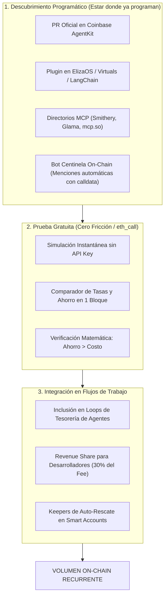

# Estrategia de Distribución Programática & Go-To-Market — FlashShift

> [!IMPORTANT]
> **El Desafío:** No se puede vender una infraestructura DeFi puerta a puerta. Los desarrolladores y agentes de IA no compran por marketing tradicional; adoptan herramientas que **ya están integradas en sus entornos de desarrollo**, que **no requieren permisos ni registros** y que **demuestran matemáticamente su beneficio antes de firmar**.

---

## 1. El Embudo de Adopción Autónoma (Zero-Friction Funnel)



---

## 2. Los 4 Canales de Distribución Autónoma (Sin Ventas 1 a 1)

### Canal A: Infiltración en los Repositorios Oficiales (El Canal Definitivo)
Los desarrolladores de agentes en Base **no buscan herramientas en Google**; importan librerías desde el repositorio de **Coinbase AgentKit**:
* **La Acción:** Crear y enviar un Pull Request oficial a `coinbase/agentkit`:
  - `flashshift-action-provider`: Provee las acciones `rebalanceDebt`, `rescuePosition` y `leverageLoop`.
* **El Resultado:** Todo desarrollador que inicializa un agente con `create-agent` o corre un bot de Coinbase en Base **ya tiene FlashShift preinstalado por defecto** en la lista de herramientas disponibles.

### Canal B: El "Bot Centinela" On-Chain (Proactive Inbound)
En vez de buscar desarrolladores, **el sistema detecta sus billeteras y les muestra la solución matemáticamente**:
* Nuestro escáner corre 24/7 monitoreando las 95 posiciones en riesgo en Base.
* Cuando detecta una billetera de un fondo, DAO o agente con HF < 1.05:
  - Genera automáticamente un reporte público en **Farcaster / BaseScan / X**:
    > *"Billetera 0x... en Morpho Base: Estás pagando 6.66% ($180k/año) en USDC. Con Aave pagarías 4.61% ($124k/año). Simulación eth_call lista: [Link / Calldata]"*
  - No es spam privado: es un **diferencial matemático público** que los desarrolladores y operadores de esas billeteras monitorean constantemente.

### Canal C: El Directorio Universal de MCP (Model Context Protocol)
El protocolo MCP de Anthropic / Claude se convirtió en el estándar para conectar LLMs con el mundo exterior:
* Publicar `@flashshift/mcp-server` en los registros oficiales: **Smithery**, **Glama**, **mcp.so**.
* Cualquier desarrollador que arme un agente en Claude Desktop, Cursor o LangGraph puede escribir:
  > *"Instalar herramientas de deuda de Base"* ➔ Su entorno descarga FlashShift automáticamente.

### Canal D: El Programa de "Builder Revenue Share" (Incentivo B2B)
Para que otros desarrolladores integren FlashShift en sus propias apps o agentes:
* **La Oferta:** *"Integra FlashShift en tu bot y quédate con el 33% de nuestra comisión (5 bps de los 15 bps)"*.
* Si un desarrollador de un agente de tesorería corre nuestro código con su dirección como `referral`:
  - En un rescate de $5M, FlashShift cobra $7.500 USD:
  - **$5.000 van a FlashShift**.
  - **$2.500 van automáticamente al desarrollador del agente**.
* Esto crea un ejército de programadores externos promocionando e integrando la herramienta para ganar comisiones pasivas.

---

## 3. Estrategia de Validación de Volumen en 3 Hitos (Roadmap Comercial)

Para no depender de supuestos teóricos, el volumen se valida en tres etapas de menor a mayor escala:

```
┌────────────────────────────────────────────────────────────────────────┐
│               HITOS DE VALIDACIÓN DE VOLUMEN (TRACCIÓN)                │
├─────────────────┬───────────────────────┬──────────────────────────────┤
│ Hito            │ Meta de Volumen       │ Validación Comercial         │
├─────────────────┼───────────────────────┼──────────────────────────────┤
│ Hito 1 (Día 15) │ $1.0M USD acumulado   │ 1 o 2 ballenas o bots        │
│ Hito 2 (Día 45) │ $10.0M USD / mes      │ Adopción en AgentKit / Eliza │
│ Hito 3 (Día 90) │ $40.0M+ USD / mes     │ Integración en Billeteras B2B│
└─────────────────┴───────────────────────┴──────────────────────────────┘
```

1. **Hito 1: Primera Operación Real Asistida ($1M):**
   - Ejecutar una primera migración de APY real para demostrar en BaseScan que el ahorro fue verificado y el Flash Loan a 0% devolvió el capital sin errores.
2. **Hito 2: Publicación de SDK y Acción en AgentKit ($10M/mes):**
   - Publicar el paquete npm y medir el volumen originado exclusivamente por llamadas automáticas de máquinas.
3. **Hito 3: Integración B2B con Agregadores ($40M/mes):**
   - Con métricas de ejecución y cero fallos en mainnet, conectar el endpoint como backend en interfaces de gestión (Rabby, Zerion o interfaces de curadores de Morpho).
