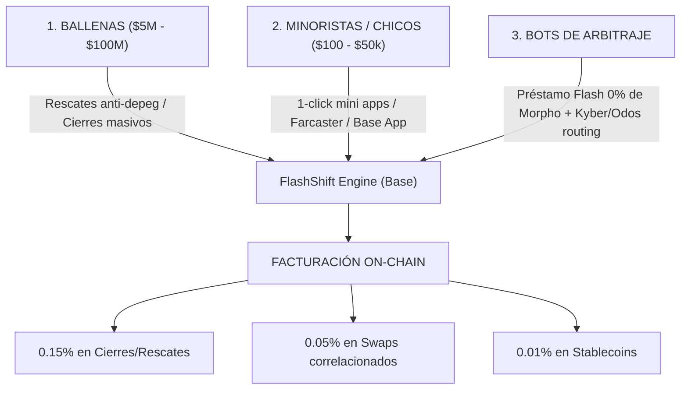

# Estrategia Multicanal de Volumen — FlashShift

---

## Los 3 Motores de Flujo de Fondos

---

## Frente 1: Las Ballenas ($5M a $100M+)
* **Objetivo:** Pocas transacciones, ingresos gigantescos por evento ($5.000 a $40.000 USD por rescate).
* **Solución:** Rescate anti-liquidación cuando el Health Factor < 1.05 o cuando sube la tasa de interés.
* **Canal:** Monitoreo on-chain automatizado, alertas en tiempo real y calldata lista para firmar vía Safe/Ledger.

---

## Frente 2: Los Chicos / Minoristas ($100 a $50.000)
* **Objetivo:** Volumen recurrente, viralidad y masa crítica comunitaria.
* **El Problema del Minorista:** Cerrar o cambiar una posición en Aave/Moonwell le toma 5 transacciones en PC, se equivoca en los pasos y gasta fricción.
* **La Solución:** 
  - **Mini App en Base App / Farcaster Frames:** Botón directo *"Cerrar y retirar en USDC"* o *"Pasar mi ETH a wstETH con yield"*.
  - No necesitan tener capital extra: el flash loan de Morpho pone los $2.000 o $10.000 temporalmente en el bloque.
  - El fee del 0.15% sobre $5.000 son apenas $7.50 USD: no lo sienten y les ahorra 20 minutos de enredos.

---

## Frente 3: Bots de Arbitraje (La Joya Oculta)
* **El Contexto:** En Base casi no quedan bots de arbitraje rentables porque:
  1. Aave cobra **0.05%** por flash loan (te come el margen del arbitraje pequeño).
  2. Balancer no siempre tiene la liquidez del token exótico.
  3. El secuenciador de Base no tiene mempool pública, así que si pagas fee por el préstamo, vas a pérdida.
* **La Oferta para Arbitrajistas:**
  - **Préstamo Flash a 0.00% permanente vía Morpho Blue:** Les abres un router optimizado en gas donde piden prestado a costo CERO.
  - Si arbitran entre Aerodrome y Uniswap v3, no pagan el 0.05% de peaje de Aave.
  - **Cómo monetizamos nosotros con ellos:** 
    - No les cobras por el flash loan (sigue siendo 0%).
    - Les provees la ruta de swap optimizada en Kyber/Odos donde tú recibes el **rebate / partner fee del agregador**.
    - O les cobras un minúsculo 0.01% - 0.02% solo si el arbitraje fue exitoso y tuvo ganancia neta.
