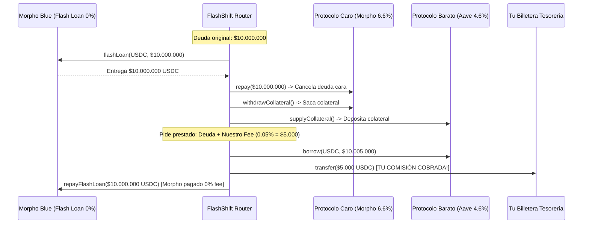

# Mecánica de Cobro: Arbitraje de APY y Refinanciamiento

> [!IMPORTANT]
> **La Regla de Oro:** El usuario **NUNCA saca plata de su billetera ni hace un pago separado**. 
> La comisión se descuenta **adentro de la misma transacción atómica** financiándola con el mismo Flash Loan. El usuario ve que su deuda se redujo, su tasa bajó, y tu comisión ya se transfirió a tu tesorería en el bloque.

---

## 1. Modelo Principal: El Fee de Refinanciamiento Atómico (Upfront Origination)

Es el modelo más limpio, estándar y seguro en DeFi (el mismo que usa la banca tradicional y los grandes protocolos).

### La Tarifa: **0.05% a 0.10%** del capital migrado
* Si mueves $10.000.000 de Morpho a Aave: cobras **$5.000 a $10.000 USD**.

### Cómo se descuenta on-chain (Flujo Exacto):



### Por qué el cliente lo ama:
* La ballena no puso un solo centavo de su bolsillo.
* Su nueva deuda en Aave es de **$10.005.000** (apenas $5k más por tu comisión).
* **Pero ahora paga 4.61% en vez de 6.66%:**
  - Antes pagaba: **$666.000 USD/año** de intereses.
  - Ahora paga: **$461.230 USD/año**.
  - **Se ahorra $204.770 USD netos al año.**
* Pagó $5.000 USD en la transacción para ahorrarse más de $200.000 USD. Negocio redondo.

---

## 2. Modelo Alternativo: Performance Fee sobre el Ahorro (% del Spread)

Si el cliente o el agente de IA prefiere pagar en función del éxito del ahorro:

* **La Regla:** *"Te cobramos el 10% del ahorro del primer año"*.
* Si la diferencia de tasas le ahorra **$50.000 USD** al año:
  - Tu comisión son **$5.000 USD**.
* Se financia exactamente igual: se suma a la nueva deuda en el protocolo de destino en el momento de la migración.

---

## 3. ¿Dónde cae el dinero? (Arquitectura de Tesorería)

1. En tu contrato Router se define una variable inmutable:
   ```solidity
   address public immutable feeRecipient;
   ```
2. Al final de la función de migración, se ejecuta:
   ```solidity
   IERC20(loanToken).safeTransfer(feeRecipient, feeAmount);
   ```
3. Cada vez que una ballena, un minorista o un agente de IA ejecuta una migración de APY:
   - Recibes **USDC directo en tu billetera o Safe** en Base en el mismo bloque.
   - Sin intermediarios, sin facturación manual, sin chargebacks.
