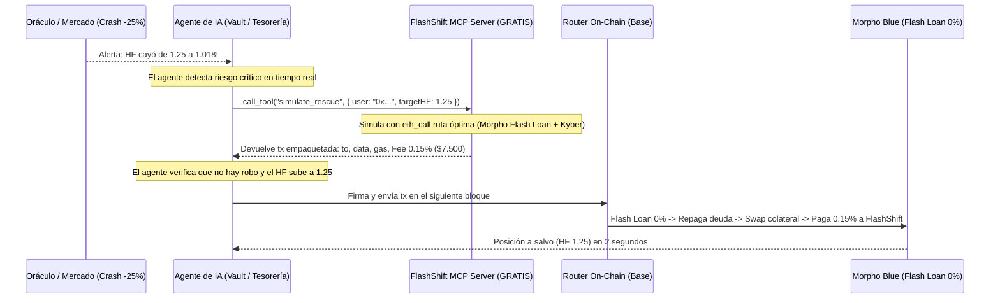

# FlashShift: Operación 100% API & MCP durante una Crisis

> [!IMPORTANT]
> **Tesis Central:** En un crash de mercado, los humanos entran en pánico, se van a dormir, se saturan las interfaces web o no reaccionan a tiempo. Los **Agentes de IA conectados por API y MCP reaccionan en el bloque 0**. Ser una infraestructura puramente *headless* (API / MCP) no es una limitación: **es la mayor ventaja competitiva en un crash**.

---

## 1. La Dinámica API/MCP durante un Crash

---

## 2. Por qué la API / MCP captura MÁS volumen que una web en una crisis

| Factor | Usuario Humano en Web | Agente de IA vía MCP / API |
|---|---|---|
| **Disponibilidad** | Duerme, trabaja, no ve el celular | **Activo 24/7/365 en milisegundos** |
| **Tiempo de Reacción** | 30 a 120 minutos (cuando ya lo liquidaron) | **1 a 2 bloques (4 segundos en Base)** |
| **Emocionalidad** | Duda, espera rebote, pánico | **Cálculo matemático puro:** Prevenir 5% penalty > Pagar 0.15% fee |
| **Fricción de interfaz** | La web se cuelga por tráfico, RPC saturado | **Llamada RPC directa / MCP local** |
| **Capacidad de escala** | 1 humano gestiona 1 posición | **1 bot de tesorería gestiona 50 sub-cuentas** |

---

## 3. Quiénes son los clientes que consumen la API / MCP

No necesitas que la gente "entre a una página web". Los clientes de la API son máquinas:

1. **Agentes de Yield & Vaults Autónomos:**
   - Bots de ElizaOS, Virtuals, Giza ARMA, Almanak que administran dinero en Base.
   - Si el mercado cae, su código les ordena: *"Llamar a flashshift_mcp para desapalancar si HF < 1.05"*.
2. **Coinbase AgentKit (La Red de Agentes de Base):**
   - Agentes creados con el kit oficial de Coinbase que tienen nuestro Action Provider instalado.
3. **Keepers y Bots de Tesorería Institucional:**
   - Fondos que corren scripts en Node.js/Python para monitorear sus propias billeteras frías y disparar rescates programados.
4. **Billeteras Web3 (Modo Backend):**
   - Apps como Rabby o Zerion consumen tu API por detrás para alimentar su botón de *"Proteger posición"* sin que el usuario sepa qué hay en el backend.

---

## 4. El Modelo Comercial Puro API / MCP

* **Llamada de lectura / simulación (`eth_call` vía MCP):** **$0.00 (100% GRATIS).**
  - Los agentes pueden consultar 100.000 veces al día sin barreras de entrada ni API keys.
* **Ejecución On-Chain (`execute`):** **0.15% de comisión atómica.**
  - La transacción que el MCP arma para el agente ya incluye la deducción del 0.15% en el swap hacia tu tesorería.
  - El agente lo acepta porque la alternativa es ser liquidado por el protocolo y perder el 5%.

### Resultado:
En un crash, mientras los sitios web colapsan, **tu servidor MCP procesa ráfagas de transacciones de agentes automatizados**, facturando decenas de miles de dólares en piloto automático.
