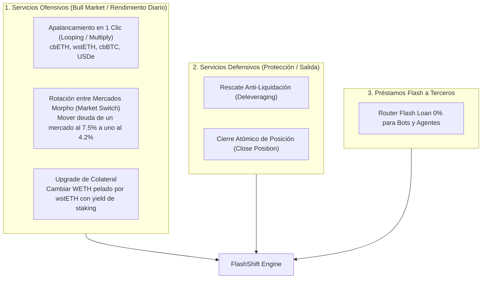

# Suite Completa de Servicios Morpho — FlashShift

> [!NOTE]
> Hasta ahora solo estábamos proyectando el negocio "defensivo" (rescates y cierres). Al sumar los servicios "ofensivos" de Morpho (Apalancamiento / Looping y Rotación de Mercados), el mercado potencial se multiplica por 3x a 5x, porque **la gente busca apalancarse y rotar rendimiento todos los días, no solo en momentos de pánico**.

---

## 1. El Catálogo Completo de Servicios Morpho

---

## 2. Detalle de los Nuevos Servicios de Alto Volumen

### A. Apalancamiento en 1 Clic (Multiply / Yield Looping)
* **Qué es:** Si el usuario tiene 10 ETH y quiere 30 ETH de exposición (apalancamiento 3x) para ganar triple rendimiento de staking (wstETH/cbETH) o puntos de Ethena (USDe/sUSDe).
* **El dolor sin FlashShift:** Hacer 5 o 6 depósitos y préstamos manuales sucesivos (lento, paga gas múltiple y necesita cálculo fino de LTV).
* **La Solución en 1 Clic (Flash Loan 0% Morpho):**
  1. Pedimos prestado el 200% en Flash Loan (Morpho).
  2. Compramos más wstETH/USDe en Kyber.
  3. Depositamos todo el colateral en Morpho.
  4. Pedimos el préstamo normal en Morpho a nombre del usuario.
  5. Pagamos el Flash Loan.
* **Fee FlashShift:** **0.05% a 0.10%** sobre el apalancamiento abierto.

### B. Rotación entre Mercados de Morpho (Market Switch)
* **El contexto en Morpho:** Morpho no es un solo pool como Aave; son **cientos de mercados aislados** (curados por Steakhouse, Gauntlet, Re7, etc.).
  - Un mercado de cbBTC/USDC puede estar al **5.8% APY**.
  - Otro mercado de cbBTC/USDC (con otro LLTV o curador) puede estar al **3.9% APY**.
* **El Servicio:** El usuario o agente aprieta un botón: *"Mover mi posición de $5M al mercado más barato"*.
  - En un solo bloque, el Flash Loan cancela el mercado caro y lo abre en el mercado barato.
  - La ballena se ahorra **1.9% anual** ($95.000 USD/año en $5M).
* **Fee FlashShift:** **0.05%** por migración de mercado.

### C. Upgrade de Colateral con Yield (Collateral Switch)
* **Caso típico:** Un usuario que tiene $500k en WETH o BTC colateralizado sin ganar nada.
* **El Servicio:** Se cambia automáticamente a **wstETH** o **cbBTC** con yield sin desarmar la deuda.
* **Fee FlashShift:** **0.05%** (swaps correlacionados).

---

## 3. Impacto Financiero: La Proyección Recalculada

Al sumar el **Apalancamiento (Multiply)** y la **Rotación de Mercados**, el volumen total se dispara:

| Servicio | Frecuencia | Volumen Mensual Estimado (Escenario Moderado) | Tarifa FlashShift | Ingreso Mensual |
|---|---|---|---|---|
| **Rescates & Cierres (Defensivo)** | Eventos de riesgo / salidas | $10.6M | 0.15% | $15.900 USD |
| **Apalancamiento / Looping (Ofensivo)** | Continuo (Demanda de yield) | **$15.0M** | **0.08%** | **$12.000 USD** |
| **Rotación de Mercados Morpho** | Optimización de tasas | **$8.0M** | **0.05%** | **$4.000 USD** |
| **Minoristas (1-click app)** | Diario | $1.5M | 0.15% | $2.250 USD |
| **Bots de Arbitraje (Router 0%)** | 24/7 | $7.5M | Rebate 0.03% | $2.250 USD |
| **TOTAL FACTURACIÓN MENSUAL** | — | **$42.6M USD** | — | **$36.400 USD / mes** |
| **TOTAL RUN-RATE ANUAL** | — | — | — | **$436.800 USD / año** 🚀 |

### Conclusión:
Teníamos una empresa de "ambulancias" (solo rescates en caídas). Al sumarle **Apalancamiento en 1 Clic** y **Rotación de Mercados**, nos convertimos en el **centro integral de gestión de posiciones de Morpho en Base**.
El negocio salta de $180k a **más de $430.000 USD al año**.
