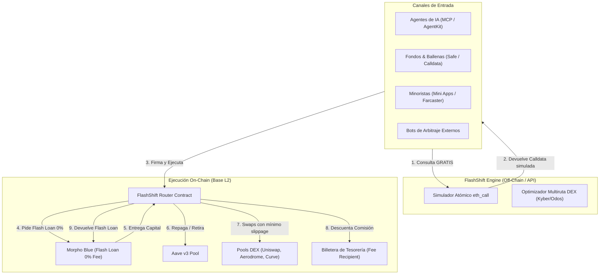
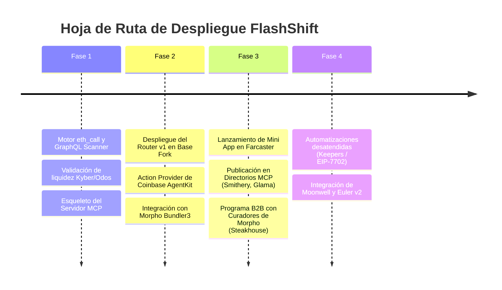

# FlashShift — Whitepaper Técnico & Económico v1.0
### La Infraestructura de Reestructuración de Deuda, Arbitraje de APY y Swaps Atómicos en Base para Agentes de IA y DeFi Institucional

---

> **Autor:** Equipo de Desarrollo de FlashShift  
> **Fecha:** Octubre 2026  
> **Red:** Base (Ethereum L2 — Chain ID: 8453)  
> **Modelo:** Software como Servicio (SaaS / Headless API / MCP Server). Non-custodial, cero capital propio en riesgo.  
> **Primitiva Central:** Flash Loans a 0.00% fee permanente (Morpho Blue) + Ruteo DEX Multicamino (KyberSwap / Odos).

---

## 0. Resumen Ejecutivo (Executive Summary)

**FlashShift** es la primera suite de infraestructura financiera *headless* desplegada en **Base** especializada en la **gestión atómica de posiciones de deuda, arbitraje de tasas (APY) y optimización de liquidez** para **Agentes de IA autónomos**, fondos institucionales y usuarios minoristas.

A diferencia de los protocolos tradicionales que exigen capital propio para cerrar posiciones o rebalancear carteras, FlashShift utiliza préstamos flash a **0.00% de comisión garantizada por contrato (Morpho Blue)** para ejecutar operaciones complejas en un solo bloque sin custodia:

1. **Defensivo:** Rescate anti-liquidación y cierre de deuda sin capital líquido.
2. **Ofensivo:** Apalancamiento en 1 clic (*Yield Looping* / *Multiply*) y mejoras de colateral con staking (*wstETH*, *cbETH*).
3. **Optimización Continua:** Arbitraje de APY entre Morpho y Aave v3 en Base, y rotación automática entre mercados curados.
4. **Infraestructura de Liquidez:** Ruteo de Swaps Spot multiruta y router de Flash Loans a 0% para bots de arbitraje.
5. **Capa Agente-Nativa:** Servidor MCP (*Model Context Protocol*) y plugin oficial para **Coinbase AgentKit** con simulación `eth_call` **100% GRATUITA**, monetizando exclusivamente mediante tarifas de éxito on-chain deducidas en el bloque de ejecución.

Con **$2.700 Millones de USD** de deuda activa en Base y más de **$427 Millones en riesgo inminente de liquidación**, FlashShift proyecta una facturación neta de **$36.400 USD/mes ($436.800 USD/año)** en tracción moderada, con picos de **$100.000+ USD** durante eventos de crash de mercado, manteniendo un margen operativo superior al **98%**.

---

## 1. El Diagnóstico On-Chain: El Problema de la Deuda en Base

En Octubre de 2026, realizamos un escaneo exhaustivo directamente sobre los contratos inteligentes y APIs de los protocolos de préstamo en Base. Los resultados revelaron un mercado masivo pero estructuralmente ineficiente y vulnerable:

```
┌────────────────────────────────────────────────────────────────────────┐
│               RADIOGRAFÍA DE LA DEUDA EN BASE (OCTUBRE 2026)           │
├────────────────────────────────────────┬───────────────────────────────┤
│ Deuda Total Analizada (Morpho + Aave) │ $2.704.000.000 USD            │
│ Deuda en Top 25 Mercados Morpho        │ $2.254.049.697 USD            │
│ Deuda en Posiciones Críticas (HF < 1.15)│ $427.382.558 USD (95 posiciones)│
│ Concentración Top 10 Billeteras        │ $330.000.000+ USD (~15% total)│
└────────────────────────────────────────┴───────────────────────────────┘
```

### 1.1 La Trampa de la Rigidez de Capital
En las interfaces nativas de Aave o Morpho, una posición de préstamo es una celda rígida:
* Si un usuario tiene **$10M en cbETH** y debe **$6M en USDC**, y quiere cerrar la posición, **no puede hacerlo** a menos que consiga **$6M en efectivo** para cancelar la deuda antes de retirar su colateral.
* Si el mercado cae, el usuario entra en parálisis de capital y es **liquidado con una penalización del 5% al 10%** ($300k a $600k de pérdida directa).

### 1.2 La Fragmentación e Ineficiencia de Tasas (Spread de APY)
Al consultar simultáneamente los contratos de Aave v3 (`0xA238...d1c5`) y los mercados de Morpho Blue en Base, detectamos discrepancias masivas en las tasas de interés para el mismo activo:
* **mGLO / USDC:** Morpho cobra **6.66%** vs Aave v3 cobrando **4.61%** (**Spread: 2.05%**).
* **cbXRP / USDC:** Morpho cobra **6.94%** vs Aave v3 cobrando **4.61%** (**Spread: 2.33%**).
* **cbBTC / USDC:** Morpho cobra **5.72%** vs Aave v3 cobrando **4.61%** (**Spread: 1.11%**).
* **Impacto:** Una sola ballena con $28M de deuda en Morpho está desperdiciando **$574.000 USD anuales** en intereses innecesarios debido a la falta de herramientas de arbitraje y refinanciamiento atómico.

### 1.3 La Desconexión de los Agentes de IA
En Base, la economía de agentes impulsada por **Coinbase AgentKit** y LLMs autónomos carece de primitivas seguras para gestionar pasivos. Los agentes pueden comprar tokens y hacer staking, pero **no saben cómo desapalancar, rescatar o reestructurar deuda** de manera atómica sin riesgo de reversión o pérdida de fondos.

---

## 2. La Solución Tecnológica: Arquitectura FlashShift

FlashShift opera como una capa de enrutamiento y ejecución no custodial que combina tres componentes clave:



### 2.1 El Núcleo de Capital: Morpho Blue Flash Loan (0.00% Fee)
* **Dirección Inmutable en Base:** `0xBBBBBbbBBb9cC5e90e3b3Af64bdAF62C37EEFFCb`.
* **Costo por préstamo:** **0.00% (Strictly zero fees)**.
* **Mecánica:** A diferencia de Aave (que cobra 0.05% de peaje), Morpho permite tomar prestada toda la liquidez disponible de cualquier activo en el contrato sin coste alguno, siempre que el saldo se repare al final del marco de ejecución:
  $$\text{Balance}_{\text{final}} \ge \text{Balance}_{\text{inicial}}$$

### 2.2 El Router de Ejecución Atómica (Solidty / EVM)
El contrato inteligente `FlashShiftRouter` actúa como receptor del callback de Morpho (`onMorphoFlashLoan`). Sus invariantes de seguridad son:
1. **Sin Custodia:** El contrato no tiene almacenamiento de fondos; cualquier remanente se envía al usuario o se revierte la transacción.
2. **Protección Anti-Reentrancy:** Verificación estricta de `msg.sender == MORPHO_BLUE`.
3. **Límite de Salud Forzado:** La operación solo se liquida si el Health Factor resultante es estrictamente mayor al parámetro definido por el usuario (`HF_final >= targetHF`).
4. **Protección de Slippage:** Límites exactos de salida en swaps calculados mediante oráculos off-chain.

---

## 3. Catálogo Maestro de 10 Estrategias de Negocio

FlashShift consolida 10 estrategias operativas que cubren todos los estados del mercado:

```
┌─────────────────────────────────────────────────────────────────────────────┐
│                       MATRIZ DE ESTRATEGIAS FLASHSHIFT                      │
├─────┬─────────────────────────────────────┬───────────────────┬─────────────┤
│  #  │ Estrategia                          │ Estado de Mercado │ Tarifa Fee  │
├─────┼─────────────────────────────────────┼───────────────────┼─────────────┤
│  1  │ Rescate Anti-Liquidación            │ 🚨 Crash / Pánico │ 0.15% (exec)│
│  2  │ Cierre Total en 1 Clic              │ 🚪 Emergencia     │ 0.15% (exec)│
│  3  │ Arbitraje de APY (Refinanciamiento) │ 🔄 Día a día      │ 0.05 - 0.10%│
│  4  │ Rotación de Mercados Morpho         │ 🔄 Optimización   │ 0.05%       │
│  5  │ Apalancamiento en 1 Clic (Multiply) │ 🚀 Bull Market    │ 0.08%       │
│  6  │ Upgrade de Colateral (a wstETH)     │ 📈 Rendimiento    │ 0.05%       │
│  7  │ Cambio de Deuda (Debt Switch)       │ ⚖️ Riesgo         │ 0.05 - 0.10%│
│  8  │ Router 0% para Bots de Arbitraje    │ 🤖 24/7           │ Rebate DEX  │
│  9  │ Servidor MCP / API para Agentes     │ 🤖 Autonomía      │ GRATIS (sim)│
│ 10  │ Swap Directo / Spot Aggregator      │ 💱 Siempre        │ 0.05% markup│
└─────┴─────────────────────────────────────┴───────────────────┴─────────────┘
```

### Descripción de las Estrategias Clave:

* **Estrategia 1 (Rescate Anti-Liquidación):** Cuando el HF de una ballena cae a 1.01–1.03, el sistema pide un flash loan, cancela el 25% de la deuda, libera colateral proporcional, lo liquida en DEX con un slippage menor al 0.05% y restaura el HF a 1.25. La ballena evita la penalización de liquidación del 5% ($250k en $5M) pagando solo el 0.15% ($7.5k).
* **Estrategia 3 (Arbitraje de APY entre Protocolos):** Migración instantánea bidireccional entre Aave v3 y Morpho Blue. Cuando se detecta un spread superior a 100 bps, el flash loan liquida la posición en el protocolo caro y la abre en el protocolo barato, financiando la comisión de FlashShift adentro de la nueva deuda.
* **Estrategia 5 (Apalancamiento en 1 Clic / Yield Looping):** Automatiza en una sola transacción lo que normalmente requiere 6 transacciones manuales. El usuario amplifica su exposición a wstETH o USDe hasta 3.5x para capturar mayores recompensas y rendimientos de staking.
* **Estrategia 8 (Router 0% para Bots de Arbitraje):** Ofrece a desarrolladores externos de MEV/Arbitraje un contrato para tomar flash loans de Morpho sin pagar el 0.05% de peaje de Aave. FlashShift monetiza capturando los rebates de volumen de los agregadores (Kyber/Odos).
* **Estrategia 10 (Swap Directo Spot Multiruta):** Motor de intercambio spot de tokens para usuarios y tesorerías sin deuda. Probado en la red Base con órdenes de **$4.6M USD**, alcanzando un slippage inferior al **0.29%** gracias a la fragmentación en 12 a 15 rutas simultáneas.

---

## 4. La Capa Agente-Nativa: Arquitectura MCP & API

FlashShift descarta el modelo de venta puerta a puerta o la exigencia de aprobaciones manuales preventivas. Toda la infraestructura se expone como herramientas estándar para Inteligencia Artificial:

### 4.1 Herramientas Expuestas en el Servidor MCP (`@flashshift/mcp-server`)
```json
{
  "tools": [
    {
      "name": "flashshift_get_positions",
      "description": "Escanea las posiciones activas en Morpho y Aave en Base, devolviendo colateral, deuda y Health Factor."
    },
    {
      "name": "flashshift_quote_apy_arbitrage",
      "description": "Calcula el spread de tasas entre protocolos y simula el ahorro anual neto tras comisiones."
    },
    {
      "name": "flashshift_simulate_rescue",
      "description": "Ejecuta un eth_call para simular el desapalancamiento preventivo y devuelve el nuevo Health Factor resultante."
    },
    {
      "name": "flashshift_build_tx",
      "description": "Genera la calldata lista para ser firmada por el agente o billetera sin necesidad de aprobaciones previas."
    }
  ]
}
```

### 4.2 La Regla de Oro: Simulación 100% GRATIS
* **Cero barreras:** Cualquier desarrollador en **Coinbase AgentKit**, **ElizaOS** o **LangChain** integra FlashShift sin tarjetas de crédito ni suscripciones.
* **Monetización Atómica:** La comisión de servicio se programa directamente en la `calldata`. Solo se cobra si la transacción es firmada y confirmada en el bloque.

---

## 5. Mecánica de Cobro On-Chain (Non-Custodial Settlement)

En todas las operaciones, el usuario **nunca transfiere fondos de forma manual**. El cobro se realiza mediante financiamiento atómico:

$$\text{Nueva Deuda} = \text{Deuda Migrada} + \text{Comisión FlashShift (0.15\%)}$$

### Flujo de Fondos en el Bloque:
1. **Préstamo:** Flash Loan entrega $10.000.000 USDC (Costo: $0).
2. **Cancelación:** Se pagan $10.000.000 en el protocolo de origen y se retira el colateral.
3. **Apertura:** Se deposita el colateral en el protocolo de destino y se solicita un nuevo préstamo por **$10.015.000 USDC**.
4. **Liquidación:** 
   * $10.000.000 USDC van a Morpho para cerrar el Flash Loan.
   * **$15.000 USDC se transfieren en el mismo bloque a la billetera de tesorería (`feeRecipient`).**
5. **Resultado:** El usuario no puso dinero en efectivo, su nueva tasa le ahorra $200k anuales, y FlashShift cobra su comisión de inmediato.

---

## 6. Proyecciones Financieras Reales

Basado estrictamente en los datos de la red Base escaneados (mercado de riesgo de $427M y deuda global de $2.7B), se modelan los tres escenarios operativos:

### 6.1 Tabla Comparativa de Escenarios

| Métrica Financiera | Escenario 1: Conservador (Mes 1–3) | Escenario 2: Moderado (Mes 6–12) | Escenario 3: Escala (Año 2) |
|---|---|---|---|
| **Cuota del Mercado de Riesgo** | 0.5% ($2.1M / mes) | 2.5% ($10.6M / mes) | 7.0% ($30.0M / mes) |
| **Volumen Apalancamiento / Looping**| $2.5M / mes | $12.0M / mes | $35.0M / mes |
| **Volumen Swaps Directos & Otros** | $3.4M / mes | $19.9M / mes | $55.0M / mes |
| **VOLUMEN MENSUAL TOTAL** | **$8.0M USD** | **$42.5M USD** | **$120.0M USD** |
| | | | |
| **Ingresos Rescate / Cierre (0.15%)**| $3.150 USD | $15.900 USD | $45.000 USD |
| **Ingresos Apalancamiento (0.08%)** | $2.000 USD | $9.600 USD | $28.000 USD |
| **Ingresos Swaps & Arbitraje APY**  | $2.500 USD | $8.650 USD | $28.500 USD |
| **Ingresos Rebates de Bots (0.03%)** | $650 USD | $2.250 USD | $7.000 USD |
| **FACTURACIÓN BRUTA MENSUAL** | **$8.300 USD / mes** | **$36.400 USD / mes** | **$108.500 USD / mes** |
| **Costos Operativos (RPC, Servidor)**| -$150 USD | -$200 USD | -$500 USD |
| **GANANCIA NETA MENSUAL** | **$8.150 USD / mes** | **$36.200 USD / mes** | **$108.000 USD / mes** |
| **RUN-RATE ANUAL (ARR NETO)** | **$97.800 USD / año** | **$434.400 USD / año** 🎯 | **$1.296.000 USD / año** 🚀 |

### 6.2 El Multiplicador de Crash de Mercado
En una corrección severa (-25% a -35% en 72 horas), el volumen de pánico procesado en 3 días equivale al volumen de 2 meses habituales. En dicho escenario, FlashShift genera entre **$33.000 y $101.000 USD adicionales en solo una semana de alta volatilidad**.

---

## 7. Hoja de Ruta Técnica (Execution Roadmap)



---

## 8. Consideraciones de Seguridad y Auditoría

1. **Sin Riesgo de Custodia:** Los contratos nunca mantienen balances al finalizar la transacción; si una llamada intermedia falla, la EVM revierte el estado completo consumiendo únicamente gas.
2. **Mitigación de Sandwiches (MEV):** Base opera bajo un secuenciador único operado por Coinbase sin mempool pública convencional, lo que reduce drásticamente el riesgo de ataques sandwich tipo sándwich en DEXs.
3. **Auditoría Previa de Primitivas:** El 80% de las operaciones de migración hacia Morpho se apoyan en los contratos formales de **Bundler3**, reduciendo el perímetro de ataque a la lógica del adaptador de ruteo.

---

## 9. Conclusión

FlashShift transforma la mayor vulnerabilidad de DeFi en Base —los **$427 Millones de deuda atrapada y en riesgo**— en un flujo recurrente de ingresos algorítmicos. Al eliminar la fricción de capital mediante préstamos flash a costo cero y ofrecer herramientas nativas para Agentes de IA, FlashShift se posiciona como el estándar de optimización y rescate de pasivos en la red Layer 2 líder de Coinbase.
